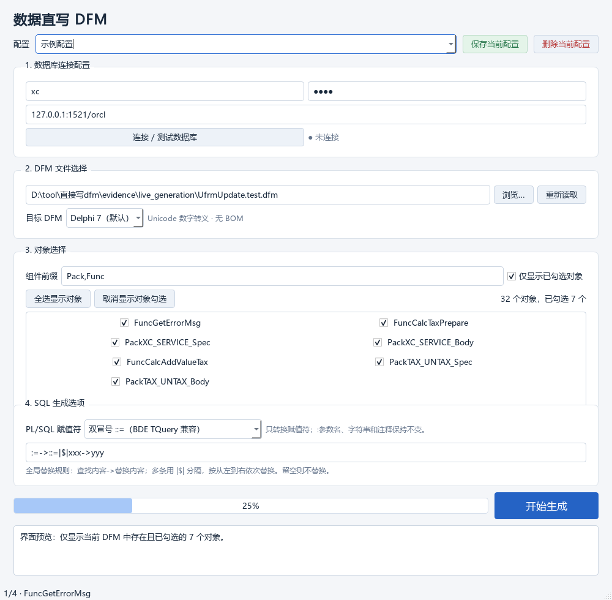

# 数据直写 DFM · DFM Writer

把 Oracle 数据库里的 PL/SQL 源码，直接写进 Delphi 文本 DFM 的 `TMemo` / `TRichEdit`。



[](https://www.python.org/)
[](https://pypi.org/project/PyQt6/)
[](https://www.oracle.com/database/technologies/instant-client.html)
[](#)
[](LICENSE)

这是一个面向 Delphi 维护场景的小工具：从 Oracle `USER_SOURCE` 读取包、函数、存储过程源码，按 Delphi 文本 DFM 的字符串语法序列化，只替换目标组件（`TMemo` / `TRichEdit`）的 `Lines.Strings`，其余窗体内容原样保留。默认生成 Delphi 7 格式，也可生成 Delphi 5 的 ANSI/GBK 格式。

---

## 为什么需要它

Delphi 窗体里的“SQL 源码”通常保存在 `TMemo.Lines.Strings` 中，而这段文本并不是普通字符串：

- 中文在 Delphi 7 里要写成 `#20013` 这样的 UTF-16 十进制转义；
- 单引号要写成 `#39`，Tab 写成 `#9`；
- 长行要按 64 个码元用 `+` 续行；
- Delphi 5 又完全不同，必须使用 GBK 引号文本，且不能出现大于 255 的数字转义；
- 手工粘贴极易破坏空格、空行、注释和结尾分号。

本工具把“取源码 → 转义 → 定位组件 → 校验 → 备份 → 原子写入”做成一次可重复的操作。

## 功能

- **按配置连接 Oracle**：保存多套用户名、密码、`主机:端口/服务名` 与 DFM 路径，下拉即切换。
- **组件前缀映射**：`COMPONENT_PREFIX` 默认 `Pack,Func`，列出名称以该前缀开头的 `TMemo` / `TRichEdit`。
- **只更新勾选对象**：支持“仅显示已勾选对象”、全选/取消显示对象，勾选状态持久化。
- **Delphi 7 / Delphi 5 双目标**：同一份数据库源码可生成两种 DFM 字符串格式。
- **PL/SQL 赋值符模式**：标准 `:=`，或 BDE `TQuery` 兼容的 `::=`；只改赋值符，不动 `:参数名`、字符串和注释。
- **全局替换规则**：`查找->替换|$|查找->替换`，按顺序执行，用于项目内的方言/命名差异。
- **安全写入**：写前备份、临时文件 + `os.replace` 原子替换、生成期间文件被改动则拒绝覆盖、写后解码回读校验。
- **只读数据库**：不执行 DDL、不编译对象、不修改数据库内容。

## 快速开始

### 方式一：运行 EXE

发行版为 Windows x64 单文件 EXE，内含 Oracle Client 19.32 Basic 与 VC 运行库，目标机器无需安装 Python、PyQt 或 Oracle 客户端。把 EXE 放在可写目录中运行即可，`config.json` 会保存在 EXE 同目录。

> 仓库不提交 110 MB 的 EXE 和 Oracle Client 二进制（见 [打包](#打包-exe)）。可自行构建，或在仓库的 Releases 中获取已构建版本。

### 方式二：源码运行

要求 **Python 3.12 x64**：

```powershell
python -m venv .venv
.\.venv\Scripts\Activate.ps1
pip install -r requirements.txt
python main.py
```

连接 Oracle 11g 需要 64 位 Oracle Instant Client（Thick 模式）。程序按以下顺序查找 `oci.dll`：

1. EXE 内嵌 / 程序目录下的 `oracle_client\`
2. `ORACLE_HOME`
3. `C:\oracle`、`D:\oracle` 等常见 Instant Client 目录
4. Navicat、DataGrip 等工具自带的 Instant Client
5. `PATH`

`oracle_client/` 需要以下文件（Basic 包 + VC 运行库）：

```text
oci.dll  oraociei19.dll  orannzsbb19.dll  oraons.dll
msvcp140.dll  vcruntime140.dll  vcruntime140_1.dll  concrt140.dll
BASIC_LICENSE  BASIC_README
```

该目录不随仓库分发，请从 Oracle 官方下载并遵守其许可。中文路径下若 OCI 加载失败，程序会自动把 DLL 缓存到英文临时路径后重试。

## 使用

1. 填写配置名称、数据库用户名、密码、`主机:端口/服务名`，点“连接 / 测试数据库”。
2. 选择无 BOM 的 ANSI/GBK 文本 `.dfm`，对象列表会自动读取；选择目标 **Delphi 7** 或 **Delphi 5**。
3. 确认 `COMPONENT_PREFIX`，勾选要更新的组件。
4. 选择 PL/SQL 赋值符（通常单冒号；仅 BDE `TQuery` 场景用双冒号）。
5. 如有需要，填写 `REPALCE_PATTEN` 全局替换规则。
6. 点“开始生成”。生成操作会自行建立数据库连接，无需先点连接。

配置在切换、关闭窗口和开始任务时自动保存；首次启动会创建“默认配置”。数据库密码按参考工具的方式明文保存在本地 `config.json` 中，请自行保护该文件。

## 对象映射

| DFM 组件 | Oracle 对象 | 说明 |
|---|---|---|
| `FuncGetErrorMsg` | `GETERRORMSG` | 通过 `USER_SOURCE` 唯一确定 FUNCTION |
| `PackXC_SERVICE_Spec` | `XC_SERVICE` | PACKAGE |
| `PackXC_SERVICE_Body` | `XC_SERVICE` | PACKAGE BODY |
| `PackTAX_UNTAX_Spec` | `TAX_UNTAX` | PACKAGE |
| `PackTAX_UNTAX_Body` | `TAX_UNTAX` | PACKAGE BODY |

- `_Spec` / `_Body` 是项目约定的组件后缀，不属于数据库对象名。
- 多个前缀同时匹配时使用最长前缀。
- 普通名称去掉前缀后，用当前用户 `USER_SOURCE` 唯一确定对象类型；未找到或类型不唯一会明确报错。
- 映射是“前缀 + 名称约定”，不是写死的对象清单；其他 `PackXxx` / `FuncXxx` 同样适用。

## 写入规则

- 按 `USER_SOURCE.LINE` 读取，保留源码空格、Tab、空行和 PL/SQL 分号；首行补 `CREATE OR REPLACE`，声明不带 schema 前缀。
- 先执行全局替换，再添加项目说明注释；已适配的对象沿用逐对象注释，其他对象使用通用注释。
- 赋值符转换会跳过字符串、引号标识符、行注释、块注释和 Oracle `q'...'` 字面量。
- **Delphi 7**：可打印 ASCII 放在单引号内；单引号写 `#39`，Tab 写 `#9`，中文等非 ASCII 写成 UTF-16 十进制转义；每段最多 64 个 UTF-16 码元。
- **Delphi 5**：中文以 GBK 直接写在单引号内；单引号仍写 `#39`，Tab 写 `#9`；每段最多 64 个 GBK 字节，不拆开汉字。
- 源码每一行对应 `Lines.Strings` 的一个列表项，空行写 `''`；长行用 `+` 续行，不改变解码内容。
- 文件按中文 ANSI/GBK 无 BOM 读取和写回，保留原换行；拒绝 UTF-8/UTF-16 BOM 和二进制 DFM。
- 只替换选中组件的 `Lines.Strings`；属性不存在时插入，其他组件和属性保持原样。
- 写入前创建 `原文件.dfm.时间戳.bak`；全部对象转换成功且解码回读一致后才提交文件。
- 选择 Delphi 5 时还会检查整份文件的数字转义，发现大于 255 的 Unicode 转义会停止覆盖，避免把 Delphi 6+ 窗体误当 D5 文件。

详细规则与实测依据：

- [DFM 数据库源码转换规则](DFM数据库源码转换规则.md)
- [Delphi 5 与 Delphi 7 兼容说明](Delphi5与Delphi7兼容说明.md)

## 项目结构

```text
.
├─ main.py                     程序入口 / --self-test
├─ run.py                      便捷启动
├─ dfm_writer/
│  ├─ core.py                  DFM 解析、编码、替换、原子写入
│  ├─ database.py              只读 USER_SOURCE 查询
│  ├─ jobs.py                  后台生成任务（QThread）
│  ├─ window.py                PyQt6 界面与配置交互
│  ├─ config.py                config.json 持久化
│  ├─ oracle_runtime.py        Oracle Client 查找与 Thick 模式初始化
│  └─ selftest.py              打包后运行自检
├─ tests/                      单元测试、独立字节解析器、在线校验脚本
├─ compat/                     原生 Delphi 加载验证源码与脚本
├─ assets/                     图标
├─ docs/                       截图与验证报告
├─ build_exe.py                PyInstaller 打包脚本
├─ analyze_dfm.py              原始 DFM 规则分析脚本（一次性）
└─ requirements.txt
```

## 测试

```powershell
python -m unittest discover -s tests -v
```

测试覆盖编码往返、替换顺序、对象映射、嵌套组件、缺失属性插入、文件编码、非目标文本保留、配置切换、勾选过滤、进度、失败不写文件、原文件变化检测，以及 Delphi 5/7 的独立字节解析验证。

在线校验脚本需要本机已有 `config.json` 和真实 DFM，默认使用名为 `lxd` 的配置：

```powershell
python tests/live_check.py config.json path\to\UfrmUpdate.dfm out\dir --profile lxd
python tests/ui_live_check.py config.json path\to\UfrmUpdate.dfm report.json lxd
```

打包后的自检只使用临时文件，不读取或修改用户配置：

```powershell
.\dist\数据直写DFM.exe --self-test .\runtime-report.json
```

真实样本测试可通过环境变量 `DFM_SAMPLE` 指向本地 DFM，并需要 `evidence/*.memo.sql` 快照；两者都不在仓库中时该测试自动跳过。

验证结论与边界见 [验证结果](验证结果.md)，可公开的报告在 [`docs/validation/`](docs/validation/)。

## 打包 EXE

1. 按上文准备 `oracle_client/` 的 10 个文件。
2. 安装依赖：

   ```powershell
   pip install -r requirements.txt
   ```

3. 构建：

   ```powershell
   python build_exe.py
   ```

脚本缺少任意运行文件会直接停止，不会产出缺客户端的精简包。产物在 `dist/数据直写DFM.exe`，约 110 MB。

## 已知边界

- 只处理**文本格式** DFM；二进制 DFM 需先在 Delphi 中 `View as Text` 保存。
- 只更新 `TMemo` / `TRichEdit` 的 `Lines.Strings`，不迁移整个窗体，也不处理第三方组件兼容性。
- Delphi 5 模式假设中文 Windows 的 CP936/GBK；遇到无法用 GBK 表示的字符会停止，而不是替换成问号。
- 程序不执行数据库 DDL、不编译数据库对象，也不启动 Delphi。
- 本机未安装 Delphi 5/7 编译器，原生加载验证源码已提供但未执行；不能把 Python 侧校验等同于 Delphi IDE 实测。
- 未在另一台干净 Windows 机器上做完整回归；EXE 的独立性通过隔离环境启动和包内清单核验。

## 许可

[MIT](LICENSE)。Oracle Instant Client、Delphi 及相关商标归各自权利人所有，不包含在本仓库中。
